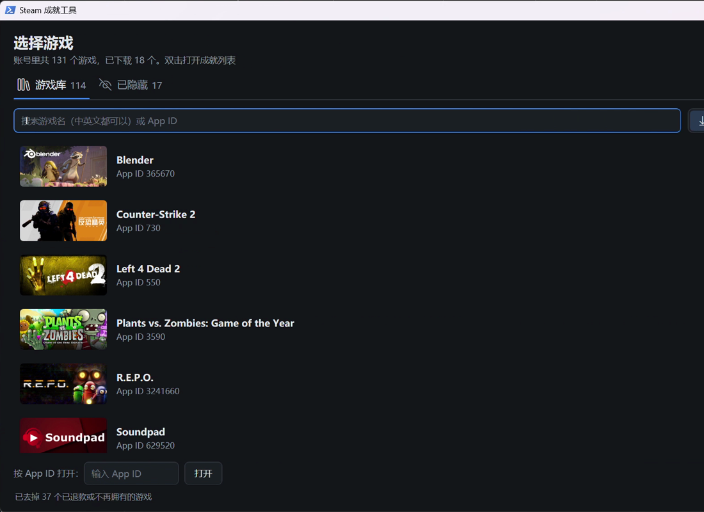
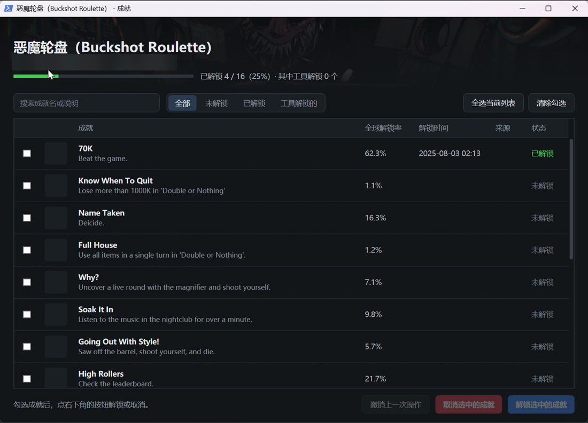
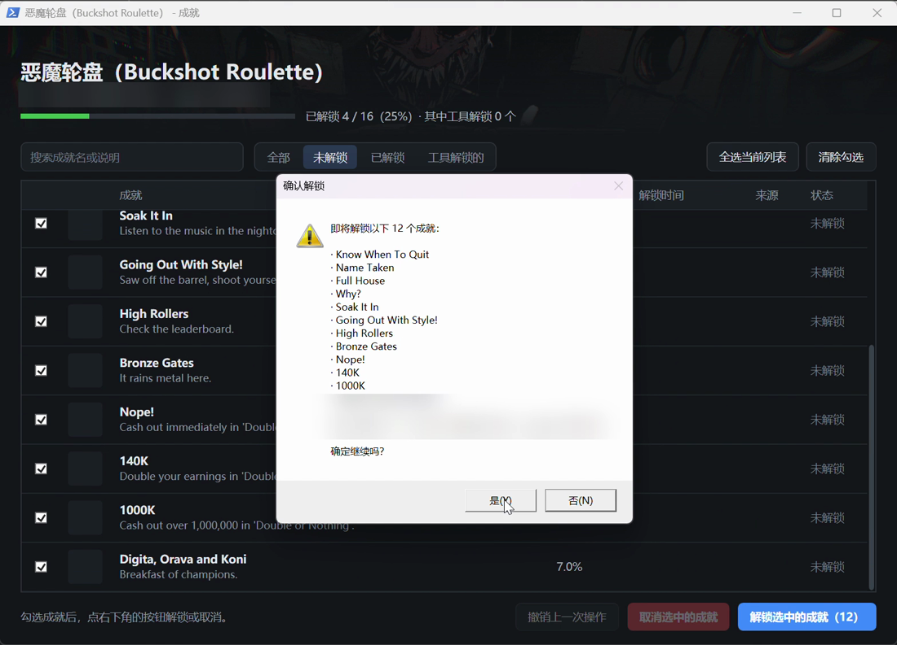

# Steam 成就工具

一个 Windows 上的 Steam 成就管理小工具：读取你的 Steam 游戏库，查看任意游戏的全部成就，勾选后一键解锁或取消，还能撤销上一次操作。

> ⚠️ **建议不要轻易使用。** 修改成就会改变你 Steam 账号上的真实数据；极个别游戏会标记异常成就。请只在自己的账号上使用，后果自负。

  
  
  

## 功能

- **自动读取游戏库**：分「游戏库」和「已隐藏」两类，可切换「已下载 / 未下载」，没下载的游戏也能改成就。
- **搜索**：支持中英文游戏名或 App ID；列表里找不到的游戏，可以在下方直接输入 App ID 打开。
- **成就列表**：显示成就图标、全球解锁率、解锁时间、来源（「工具」= 用本工具解锁的）和状态。
- **筛选**：全部 / 未解锁 / 已解锁 / 工具解锁的，也可以搜索成就名或说明。
- **批量操作**：「全选当前列表」只勾选当前筛选后看得到的成就；选中几行后按空格可以一起勾选。
- **确认弹窗**：解锁或取消前会列出将要改动的成就，确认后才提交。
- **撤销**：「撤销上一次操作」会把本工具上一次对这个游戏的解锁或取消恢复原状。
- **多窗口**：每个游戏打开一个独立的成就窗口，可以同时开多个。
- 打开后会向 Steam 核对一次，自动去掉已退款或不再拥有的游戏。

## 运行环境

- Windows 10 / 11（自带的 Windows PowerShell 5.1 即可，无需安装其他东西）
- 已安装并登录 Steam 客户端，使用时保持 Steam 打开

## 下载和使用

1. 点本页右上角绿色的 **Code → Download ZIP**，解压到任意文件夹。
2. 登录 Steam，保持 Steam 客户端打开。
3. 双击 **`打开成就工具.cmd`**。
4. 在游戏列表里双击游戏（或输入 App ID）打开成就窗口。
5. 勾选成就，点「解锁选中的成就」或「取消选中的成就」，在确认框里确认。
6. 回到 Steam 刷新成就页，核对结果。

更详细的说明见 [`使用说明.txt`](使用说明.txt)。

### 怎么查游戏的 App ID

- 游戏商店页网址里 `/app/` 后面的数字，例如 `store.steampowered.com/app/550/` 就是 `550`。
- 也可以在 Steam 库里右键游戏 → 属性 → 更新，或在 steamdb.info 搜索。

## 注意事项

- 取消成就后，原来的解锁时间不会保留；之后在游戏里重新完成会记录新的时间。
- 按游戏内统计触发的成就（例如「击杀 1000 个敌人」），如果存档或统计已经达标，游戏下次启动时可能会重新解锁它。
- 仅限游戏服务器授予的成就需要在游戏里完成，本工具无法修改。
- 工具本身不访问网络，只通过本机的 Steam 客户端读写成就；操作记录和日志保存在 `%LOCALAPPDATA%\SteamAchievementSelector\`。

## 不会用？

遇到问题可以在本仓库提 Issue，或者直接私信我。

## 免责声明

本工具仅供学习和个人使用。使用本工具造成的任何后果（包括但不限于账号数据变化、游戏内或平台的处理）由使用者自行承担。本项目与 Valve / Steam 无任何关联。
